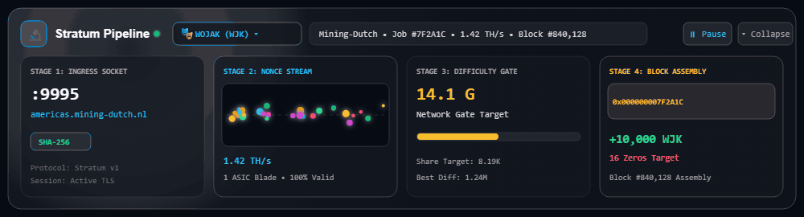
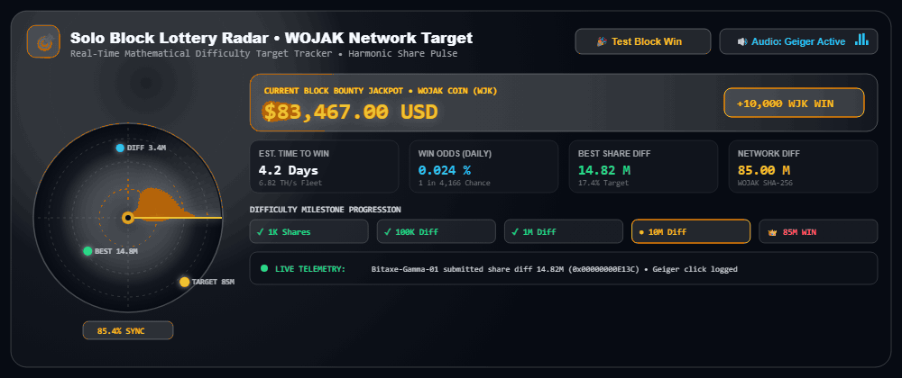
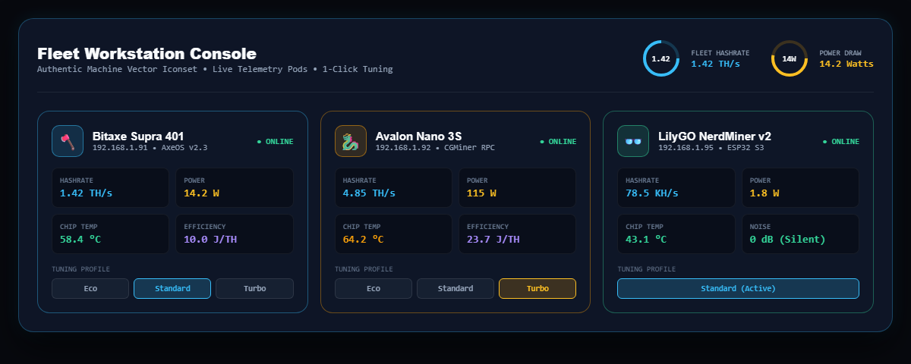
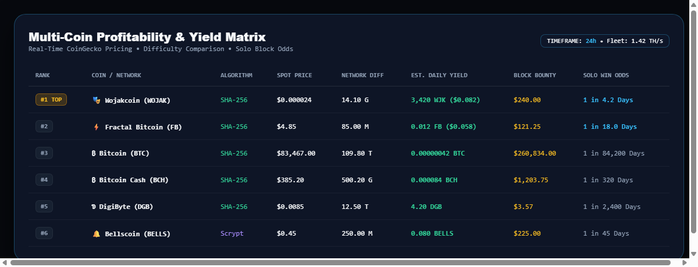
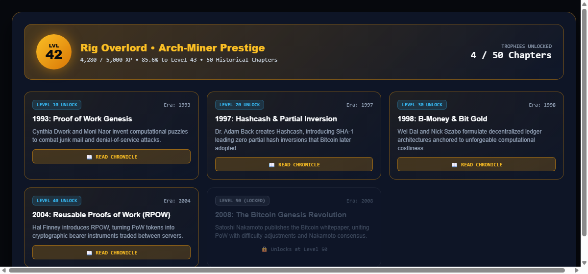
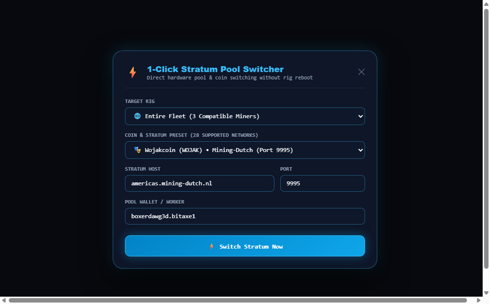
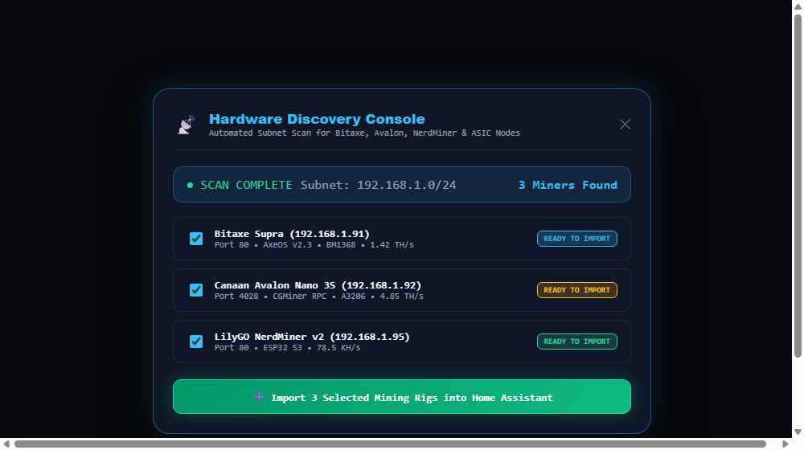
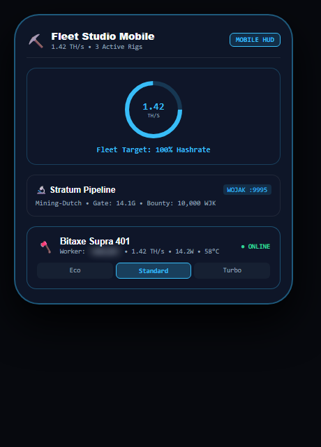
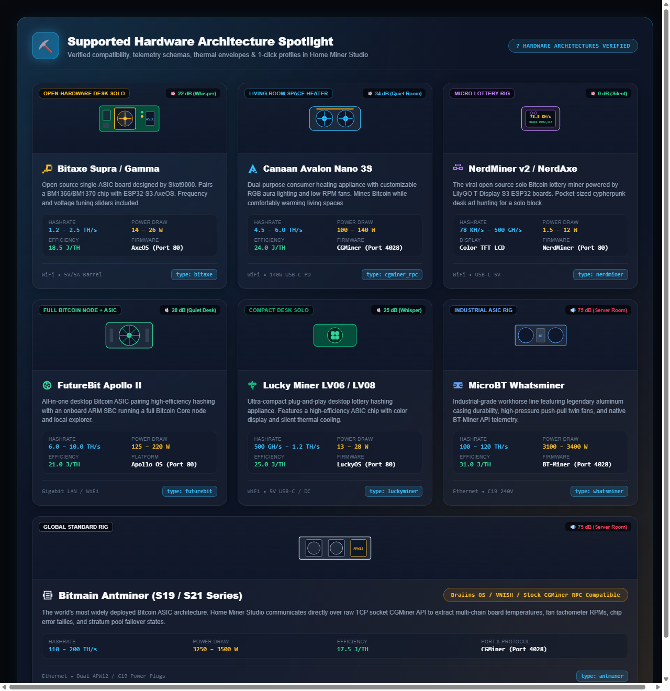

# ⚡ Home Miner Studio — Home Assistant Mining Hub & Lovelace Dashboard

[-00e676?style=flat-square&logo=github)](https://github.com/everyday3d/home-miner-studio/releases/latest)
[](https://hacs.xyz)
[](https://www.home-assistant.io/)
[](https://github.com/everyday3d/home-miner-studio/discussions/7)
[](LICENSE)

**Home Miner Studio** is a unified, privacy-first Home Assistant custom integration and interactive Lovelace dashboard designed specifically for home cryptocurrency miners. It bridges local ASIC, micro-miner (Bitaxe, NerdMiner), and GPU rig telemetry directly into Home Assistant's native entities, energy dashboards, and solar automations.

---

## 🌟 Feature Spotlight & Visual Showcase

Explore the flagship visual modules and interactive engineering built into Home Miner Studio:

### 🔬 1. Live Stratum Particle Pipeline (Visual Block Assembly)

> **Live Nonce Telemetry & Block Assembly**: High-framerate HTML5 canvas visualizer animating live stratum nonces streaming into candidate block headers, featuring golden nonce detection, Merkle root verification, and 1-click multi-coin switching across Mining-Dutch & HeliosPool SHA-256 ecosystems.

### 🎯 2. Solo Block Lottery Radar & Acoustic Telemetry

> **Live Solo Odds & Milestone Radar**: Mathematical solo block jackpot odds calculator featuring an animated 360° sweeping radar, real-time target distance blips, victory particle fanfare, and synthesized Geiger-counter audio feedback.

### 🖥️ 3. Fleet Holographic Workstations & Machine Art Iconset

> **Unified Hardware Command**: Real-time aero-glass workstation cards tracking individual ASIC hashrates, core thermals, fan tachometers, and frequency/voltage tuning with custom machine art vector iconography.

### ⚡ 4. Multi-Coin Live Yield Matrix

> **Real-Time Profitability Engine**: Dynamic SHA-256 coin profitability leaderboard ranking network difficulty, block subsidies, and net USD/day margins factoring in local electricity tariffs.

### 🏆 5. Decentralized Chronicles & Historical Trophy Room

> **Fleet RPG Progression**: 50 unlockable Bitcoin history lore chapters, 20 prestige ranks, achievement trophies, and 5 dynamic glass themes celebrating cypherpunk milestones from Level 1 to 500.

### 🔄 6. 1-Click Stratum Pool Switcher

> **Direct Hardware Remote Provisioning**: Instant modal dispatching new stratum URLs, ports, and worker credentials directly to AxeOS and CGMiner hardware without web UI logins.

### 🔍 7. Automated Subnet Rig Discovery Console

> **Zero-Config Onboarding**: Network scanner detecting AxeOS nodes, CGMiner sockets, and existing Home Assistant integrations for 1-click fleet onboarding.

### 📱 8. Mobile Companion HUD & Responsive Glass Layout

> **Pocket Mining Operations**: Touch-optimized responsive interface bringing live fleet hashrates, lottery sweeps, quick tuning controls, and yield metrics to smartphones and companion wall tablets.

---

## 🛠️ Supported Hardware Architecture Spotlight

Home Miner Studio is architected from the ground up to support the full spectrum of modern cryptocurrency mining hardware — from ultra-quiet open-source desktop lottery gadgets to industrial megawatt hashboards.



### 📊 Supported Hardware Matrix

| Hardware Architecture | Hardware Class | Hashrate Range | Power Draw | Efficiency | Noise Level | Protocol & Port | Native HA Preset |
|:---|:---|:---|:---|:---|:---|:---|:---|
| **Bitaxe Supra / Gamma** | Open-Hardware Desk Solo | 1.2 – 2.5 TH/s | 14 – 26 W | 18.5 J/TH | 🔇 22 dB (Whisper) | AxeOS HTTP (Port 80) | `type: bitaxe` |
| **NerdQaxe (Quad-ASIC)** *(Untested)* | Open-Hardware Quad Solo | 2.0 – 4.8 TH/s | 50 – 110 W | 20.0 J/TH | 🔇 28 dB (Quiet Desk) | AxeOS HTTP (Port 80) | `type: nerdqaxe` |
| **Canaan Avalon Nano 3S** | Living Room Space Heater | 4.5 – 6.0 TH/s | 100 – 140 W | 24.0 J/TH | 🔇 34 dB (Quiet Room) | CGMiner RPC (Port 4028) | `type: cgminer_rpc` |
| **NerdMiner v2 / NerdAxe** | Micro Desk Art Lottery Rig | 78 KH/s – 500 GH/s | 1.5 – 12 W | Passive Thermal | 🔇 0 dB (Silent) | NerdMiner HTTP (Port 80) | `type: nerdminer` |
| **FutureBit Apollo II** | Full Bitcoin Node + ASIC | 6.0 – 10.0 TH/s | 125 – 220 W | 21.0 J/TH | 🔇 28 dB (Quiet Desk) | Apollo OS HTTP (Port 80) | `type: futurebit` |
| **Lucky Miner LV06 / LV08** | Compact Desk Solo ASIC | 500 GH/s – 1.2 TH/s | 13 – 28 W | 25.0 J/TH | 🔇 25 dB (Whisper) | LuckyOS HTTP (Port 80) | `type: luckyminer` |
| **MicroBT Whatsminer (M30S/M50)** | Industrial High-Throughput Rig | 100 – 120 TH/s | 3100 – 3400 W | 31.0 J/TH | 🔊 75 dB (Server Room) | BT-Miner RPC (Port 4028) | `type: whatsminer` |
| **Bitmain Antminer (S19/S21)** | Global Standard ASIC Rig | 110 – 200 TH/s | 3250 – 3500 W | 17.5 J/TH | 🔊 75 dB (Server Room) | Braiins / Stock RPC (Port 4028) | `type: antminer` |

### 🛠️ Hardware Spotlight Profiles

* ⚡ **Bitaxe Supra & Gamma (BM1366 / BM1370)**:
  * Open-source single-ASIC board designed by Skot9000 & the open hardware mining community.
  * Direct AxeOS REST integration over local WiFi.
  * Interactive target frequency (`MHz`) and core voltage (`mV`) tuning sliders with live power profiling (`Eco`, `Standard`, `Turbo`).
* 🎛️ **NerdQaxe (Quad-ASIC BM1366 / BM1368 / BM1370)** *(Community Experimental • Untested)*:
  * Open-hardware quad-ASIC desktop powerhouse combining 4 BM13xx chips on a single die cluster with an ESP32-S3.
  * Direct AxeOS REST HTTP integration over local WiFi with unified multi-chip telemetry.
  * Interactive frequency (`MHz`) and voltage (`mV`) overclocking console with instant power presets (`Eco`, `Standard`, `Turbo`).
  * > [!NOTE]
  * > **Hardware Status (Untested)**: This integration was implemented following official AxeOS REST specifications. Physical hardware validation is pending — feedback and telemetry reports from NerdQaxe owners are welcome!
* 🛋️ **Canaan Avalon Nano 3S**:
  * Dual-purpose quiet room heating appliance with customizable RGB lighting halos.
  * Communicates via raw TCP socket CGMiner RPC protocol on port 4028.
  * Real-time telemetry for intake/exhaust thermals, hashboard yields, and power consumption.
* 👓 **LilyGO NerdMiner v2 & NerdAxe**:
  * The viral ESP32-S3 open-source solo Bitcoin lottery miner.
  * Pocket-sized cypherpunk desk art tracking network block height, difficulty, and accepted nonces.
* 🚀 **FutureBit Apollo II**:
  * High-efficiency desktop Bitcoin ASIC paired with an onboard ARM computer running a full Bitcoin Core node and local block explorer.
  * Complete Apollo OS API integration tracking hash performance, system thermals, and node sync.
* 🍀 **Lucky Miner LV06 & LV08**:
  * Micro-ASIC appliances powered by BM1366 chips with built-in color displays and whisper-quiet cooling.
* 🏭 **MicroBT Whatsminer & Bitmain Antminer**:
  * Full industrial socket telemetry: multi-chain hashboard temperatures, twin 6,000 RPM fan tachometers, chip error counts, and automated pool failover states.
  * Compatible with stock Bitmain firmware, Braiins OS, VNISH, and standard CGMiner RPC.

---

## 🌟 Key Features

* 🔍 **Zero-Config Auto-Import & Network Discovery**:
  * Scans existing Home Assistant integrations (`bitaxe`, `ha_bitaxe`, `axeos`, `antminer`, `whatsminer`, `braiins`, `hiveos`, `nicehash`, `nerdminer`).
  * Auto-discovers local network ASIC nodes and AxeOS blades with 1-click import into Home Assistant.
* 🎮 **Fleet RPG Progression & Prestige Themes (Level 1 to 500)**:
  * **XP Progression Engine**: Rebalanced rewards granting 1 XP per verified accepted share plus logarithmic difficulty milestone bonuses.
  * **Unlockable Rank Titles**: 20 distinct prestige ranks with custom badges from *Silicon Initiate* to *Omniscient Genesis Node*.
  * **Prestige Theme Engine**: 5 handcrafted aero-glass themes unlocked at level milestones (Cyberpunk Neon, Bitcoin Gold, Solar Pulse, Matrix Terminal, Obsidian Stealth).
  * **Mining History & Decentralized Chronicles**: 50 unlockable educational chapters unlocked every 10 levels demystifying Bitcoin mining history, cypherpunk milestones, and blockchain mechanics.
* 🔬 **Live Stratum Particle Pipeline (Visual Block Assembly)**:
  * Compact, collapsible canvas visualizer animating live stratum hashing nonces.
  * Real-time stratum telemetry: active pool host/port, block height, Merkle root hash, job seed ID, and golden nonce counter.
* ⚡ **Multi-Coin Live Yield Matrix & 1-Click Stratum Switcher**:
  * Real-time profitability leaderboard for SHA-256 coins (BTC, BCH, DGB, FB, WOJAK, BELLS, PEPE, KAS).
  * Net USD/day and monthly profit calculations taking utility electricity tariffs into account.
  * 1-Click Stratum Switcher modal pushing new pool endpoints directly to miners without manual web UI logins.
* 🎯 **Solo Block Lottery Radar & Acoustic Telemetry**:
  * Mathematical solo block bounty odds calculator based on fleet hashrate vs network difficulty.
  * 360° sweeping radar stage with dynamic distance blips for best difficulty shares and target milestones.
  * Interactive victory fanfare celebration with particle confetti.
  * Synthesized acoustic feedback with selectable audio modes: Geiger counter clicks and victory milestone chimes.
* 🎨 **Native Machine Art Custom Iconset**:
  * Extended custom vector icons registered directly on `window.customIcons['miner']`:
    * `miner:bitaxe` — Official Bitaxe dual-faceted pickaxe
    * `miner:nerdqaxe` — Quad 2x2 ASIC die cluster with cypherpunk core
    * `miner:avalon` — Canaan Avalon stylized dual-wing emblem
    * `miner:nerdminer` — LilyGO T-Display board with cypherpunk glasses
    * `miner:futurebit` — Apollo multi-blade turbine intake
    * `miner:luckyminer` — Lucky Miner four-leaf clover
    * `miner:whatsminer` — MicroBT dual-barrel aerodynamic chassis
    * `miner:antminer` — Bitmain APW12 server rack chassis
* 🏊 **Mining Pool Telemetry (7 Integrated Providers)**:
  * **Helios Pool (`helios`)**: Solo CKPool architecture tracking, live worker hashrates, session & lifetime difficulty best share (`pool_best_share`), and solo block lottery bounty tracking.
  * **Mining-Dutch (`mining_dutch`)**: Multi-algo auto-exchange telemetry, confirmed & unconfirmed BTC wallet balances, 24-hour estimated revenues, and worker status.
  * **Public-Pool (`public_pool`)**: Open-source solo Bitcoin mining pool API, real-time worker count, individual rig hashrates, and best difficulty share.
  * **2Miners (`2miners`)**: PPLNS & SOLO multi-coin pool API, real-time unpaid balance, 24h reward estimates, active workers, and pool-side hashrate.
  * **Braiins Pool (`braiins`)**: SlushPool / Braiins scoring hash rate, unconfirmed rewards, 24h estimated revenue, and worker connectivity.
  * **ViaBTC (`viabtc`)**: PPS+ / PPLNS multi-coin pool API, observer token telemetry, active worker count, and unpaid profit tracking.
  * **F2Pool (`f2pool`)**: Global multi-coin pool API, real-time hashrate, 24h reward estimates (`value_today`), and worker counts.
* ⚡ **Home Assistant Energy Dashboard Integration**:
  * Exposes native `device_class: power` (W) and `device_class: energy` (kWh) entities.
  * Directly links power draw to utility rates and solar production for dynamic cost calculations.
* ☀️ **Solar Curtailment & Smart Automation**:
  * Automatically throttle or pause miners when solar battery state-of-charge (SoC) drops or grid tariffs spike.
  * Thermal watchdog automations for smart plug kill switches when ambient/chassis temperatures rise.
* ⌚ **Apple Watch Companion Wrist HUD & Complications**:
  * **Dedicated Pure-Black OLED Wrist HUD**: Ultra-compact, high-contrast `#000000` watchOS dashboard mode designed specifically for Apple Watch 40mm, 41mm, 44mm, 45mm, and 49mm Ultra viewports (`view_mode: watch`).
  * **Micro Orbit Hashrate Ring Dial**: SVG neon progress ring showing real-time TH/s (or GH/s), electrical wattage, and hottest chip thermals at a glance.
  * **2x2 Wrist Glance Grid**: Real-time Net 24h Profit (`+$X.XX/d`), fleet electrical efficiency (`J/TH`), solo block best share, and active rig count.
  * **1-Tap Haptic Wrist Actions**: Instant 40px touch buttons with tactile press compression and `navigator.vibrate` haptic pulses (🌱 Eco mode, 🔥 Turbo mode, 🔄 Hardware Reboot).
  * **Native watchOS Complication Telemetry**: Sensor attributes pre-formatted for Home Assistant iOS Companion watch faces (Circular, Corner, Modular, Graphic Rectangular).

---

## 📦 Directory Structure

```text
home-miner-studio/
├── assets/
│   ├── stratum_pipeline_animated.gif   # Animated canvas particle pipeline visualizer
│   ├── solo_lottery_radar_animated.gif # Animated 360° sweeping lottery radar display
│   ├── solo_lottery_radar.png          # Solo lottery 360° radar display
│   ├── fleet_workstations.png          # Unified fleet workstation telemetry
│   ├── yield_market_matrix.png         # Multi-coin SHA-256 yield matrix
│   ├── chronicles_trophy_room.png      # 50-chapter lorebook & prestige trophies
│   ├── stratum_switcher_modal.png      # 1-Click stratum switcher modal
│   ├── network_discovery_console.png   # Subnet ASIC auto-discovery console
│   ├── mobile_companion_hud.png        # Mobile responsive touch HUD
│   └── hardware_spotlight_showcase.png # Hardware architecture spotlight graphic
├── custom_components/
│   └── home_miner_studio/
│       ├── __init__.py          # Integration setup & frontend card registration
│       ├── manifest.json        # HA manifest
│       ├── config_flow.py       # Discovery & UI configuration flow
│       ├── const.py             # Constants & API schemas
│       ├── coordinator.py       # DataUpdateCoordinator for miners & pools
│       ├── discovery.py         # Auto-import scanner for existing integrations
│       ├── sensor.py            # Hashrate, power, temp, earnings, pool sensors
│       ├── binary_sensor.py     # Health, overheat, pool alive status
│       ├── switch.py            # Mining pause / resume & power toggles
│       ├── button.py            # Reboot miner & restart process
│       ├── number.py            # Frequency & voltage tuning sliders
│       ├── select.py            # Power profile presets (Eco / Standard / Turbo)
│       ├── home-miner-cards.js  # Custom Lovelace card frontend
│       ├── home-miner-icons.js  # Custom vector iconset provider (miner:*)
│       └── translations/
│           └── en.json          # English translations
├── hacs.json                    # HACS repository configuration
├── CHANGELOG.md                 # Release history
├── LICENSE                      # MIT license
└── README.md                    # Documentation
```

---

## 🚀 Installation & Setup

### Via HACS (Recommended)
1. In Home Assistant, open **HACS** > **Integrations**.
2. Click the three dots in the top right > **Custom repositories**.
3. Add `https://github.com/everyday3d/home-miner-studio` with category **Integration**.
4. Search for **Home Miner Studio** and click **Download**.
5. Restart Home Assistant.
6. Go to **Settings** > **Devices & Services** > **Add Integration**, search for **Home Miner Studio**, and follow the on-screen setup.

### Lovelace Dashboard Card

#### Desktop & Tablet Fleet View
Add the custom card to any Lovelace dashboard view:

```yaml
type: custom:home-miner-fleet-card
```

#### ⌚ Apple Watch Companion Wrist HUD
To dedicate a Lovelace dashboard or subview specifically to Apple Watch screens, set `view_mode: watch` (this mode is also automatically activated on viewports `<= 280px`):

```yaml
type: custom:home-miner-fleet-card
view_mode: watch
```

#### ⌚ Apple Watch Complications Setup (Home Assistant iOS Companion)
Home Miner Studio hashrate sensors automatically export pre-formatted watchOS complication attributes on `sensor.<miner>_hashrate_ths` and `sensor.<miner>_hashrate_ghs`:

* **Circular / Small Modular**:
  ```jinja2
  {{ state_attr('sensor.my_bitaxe_hashrate_ths', 'watch_short_text') }}
  ```
  *(Outputs: `3.8T` or `450G`)*

* **Infograph Corner**:
  ```jinja2
  {{ state_attr('sensor.my_bitaxe_hashrate_ths', 'watch_corner_text') }}
  ```
  *(Outputs: `3.82 TH/s`)*

* **Modular Large / Graphic Rectangular**:
  * Line 1: `{{ state_attr('sensor.my_bitaxe_hashrate_ths', 'watch_modular_line1') }}` *(e.g. `3.82 TH/s • 128W`)*
  * Line 2: `{{ state_attr('sensor.my_bitaxe_hashrate_ths', 'watch_modular_line2') }}` *(e.g. `+$1.24/d • 58°C`)*

* **Gauge Complication (0–100%)**:
  ```jinja2
  {{ state_attr('sensor.my_bitaxe_hashrate_ths', 'watch_gauge_pct') }}
  ```

---

## 📄 License

Distributed under the MIT License. See [LICENSE](LICENSE) for more information.
